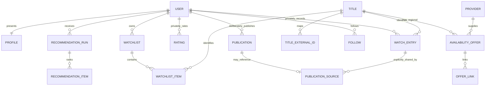

# Database design

Logical PostgreSQL schema proposal. This is a reviewable design, not a runnable migration or a claim that authorization is already implemented. UUID primary keys unless a composite key is stated; UTC timestamps; ISO country/language codes; currency stored separately from monetary minor units. Add created/updated timestamps to mutable entities.

## Accounts and permissions

| Table | Key fields and constraints |
| --- | --- |
| `auth.users` | Managed auth identity; email and credentials never copied to public profile responses. |
| `profiles` | `user_id` PK/FK, case-insensitive unique handle, display name, bio, avatar asset, `visibility` default public, `indexable` default false. Contains no history-derived fields. |
| `user_preferences` | `user_id` PK/FK, region default IN, UI locale, preferred languages/genres, history-personalization flag, future-history audience default private, profile/list defaults, preferences version. Owner only. |
| `consent_receipts` | user, purpose, version, granted/withdrawn time, audience/scope when relevant. Minimal audit content, no unnecessary title payload copies. |
| `user_subscriptions` | user, provider/plan, country; unique user/provider/plan/country. Self-declared access, never OAuth tokens or OTT passwords. |
| `follows` | follower/followee composite unique, status requested/accepted, timestamps; no self-follow. Private profiles require acceptance. |
| `blocks` | blocker/blocked composite unique, no self-block. Both directions deny social access. |
| `privacy_audit` | owner, action, scope ID, old/new audience, request ID, time. Owner-accessible minimal receipts; restricted administration. |

## Catalog, taxonomy and provenance

| Table | Key fields and constraints |
| --- | --- |
| `titles` | ID, kind movie/series, slug, original title, original language, synopsis, release date, movie runtime nullable, status, adult flag, catalog state. Runtime positive when present. |
| `title_external_ids` | title, vendor, external media type, external ID; unique vendor/type/external ID. |
| `title_translations` | title/locale composite unique, translated name, overview and source. |
| `title_aliases` | title, locale, alias, alias type; unique normalized title/alias/locale for multilingual and Romanized search. |
| `title_countries` | title/country unique; country of production is distinct from offer region. |
| `series_seasons` | series, season number, title/date; unique series/season. |
| `episodes` | season, episode number, title, runtime/date; unique season/episode. |
| `people` and `person_external_ids` | person identity plus external mapping; names are not unique identifiers. |
| `credits` | title/person/role/character, department, billing order; cast/director/creator preserved as distinct roles. |
| `genres`, `title_genres` | stable taxonomy codes and unique title/genre join. |
| `themes`, `title_themes` | editorial/vendor provenance, confidence, taxonomy version; covers mood/subgenre without pretending certainty. |
| `certifications` | title, country, classification system, value, source, observed date; never treat one region's certification as worldwide. |
| `external_ratings` | title, source, score, scale, vote count, license/provenance, observed date. Bounds check against scale; no blended IMDb label. |
| `media_assets` | title/person target, type, source URL/reference, locale, dimensions, rights reference, attribution, allowed cache-until. |
| `trailers` | title, host, video ID, official-uploader verification state, locale, source, link/embed permission state. |
| `data_sources`, `source_policies` | vendor, agreement reference, permitted fields/uses/regions, retention/refresh constraints, attribution, active dates. No credentials. |
| `field_provenance` | entity, field group, vendor record ID, fetched time, valid-until, policy version. Enables removal/replacement by source. |

## Providers and availability

| Table | Key fields and constraints |
| --- | --- |
| `providers` | stable ID, canonical slug, current display name, logo asset, official domain allowlist, active status. |
| `provider_external_ids` | provider/vendor/external ID, country, effective dates; preserve renames and mappings. |
| `provider_plans` | provider, plan/channel identity, base/add-on classification, parent plan where needed. |
| `provider_region_coverage` | provider/country/vendor/plan, supported/unknown state, verified time, evidence reference. |
| `availability_offers` | title, optional season/episode, provider/plan, country, monetization type, price minor units/currency, quality, audio/subtitles, start/end, fetched time, fresh-until, vendor/offer ID. |
| `offer_links` | offer, web/app destination, platform, host, source, verified time/status; never accept arbitrary user destinations. |
| `ingestion_runs` | vendor, cursor, start/end/status, record and quota counts, sanitized errors, retry marker. |
| `identity_review_queue` | ambiguous source records with proposed IDs and review state; no silent title-name merge. |

Store separate offers for rent, buy, subscription and add-ons. A series-level offer never proves every season is available. Prefer a real vendor offer ID; otherwise derive a canonical deduplication key including source/title/region/provider/plan/type/season/episode. Expiry and freshness are different fields. Never create a uniqueness constraint that collapses two valid editions or plans.

## Private library and social publication

| Table | Key fields and constraints |
| --- | --- |
| `watch_entries` | user, title, watched date nullable, rewatch sequence, audience default private, audience receipt nullable, version. Private includes counts/dates. Broad audience requires a deliberate visibility operation. |
| `ratings` | user/title unique, integer half-stars 1–10, audience default private, receipt, version. Changing rating never creates history. |
| `title_preferences` | user/title unique, liked/disliked/neutral, not-interested flag, favorite flag; owner only. |
| `watchlists`, `watchlist_items` | list owner/name/audience default private, list/title unique, order. Public rendering resolves list permission and each intentionally included item. |
| `publications` | author, kind recommendation/rating/favorite/watched/list, title or list target, optional body, explicit audience, status draft/published/withdrawn, consent receipt, published/withdrawn times, version. |
| `publication_sources` | publication FK and typed optional watch/rating/list FK with exactly-one-source constraint where required. Independent recommendations need no watched source. |
| `activity_outbox` | publication/version/event unique, delivery state, time. Contains publication ID rather than a copied private payload. |
| `reports` | reporter, publication/profile target, reason, moderation state; restricted access. |

Use real FKs for source objects or dedicated typed join tables; avoid an unenforced polymorphic `object_id`. Public favorite display is a publication, not an unrestricted read of private preferences. Community rating calculations use deliberately public current ratings only in V1; deduplicate one rating per user/title and exclude withdrawn/blocked/moderated records as applicable.

## Recommendations and measurement

| Table | Key fields and constraints |
| --- | --- |
| `interactions` | owner, title, action, timestamp, purpose, idempotency key; private. Do not retain duplicate watch-event history after deletion. |
| `title_features` | title, feature/model version, sparse metadata features; later permitted embeddings, source policy. |
| `user_taste_profiles` | owner/model version, private weighted vector, input version, recomputed time; delete/recompute on source deletion or consent change. |
| `recommendation_runs` | owner or short-lived anonymous context, model version, filter/context hash, seed, time; private and retention-limited. |
| `recommendation_items` | run/title unique, rank, score components, explanation evidence IDs, eligibility snapshot. Evidence is authorized at render time. |
| `recommendation_events` | run, item, impression/click/save/dismiss, event ID unique, time; authorized owner/ephemeral session only. |
| `experiments` | experiment/version, assignments where permitted, start/end; never encode private history in URLs. |
| `sponsored_placements` | campaign/title, placement window, disclosure, commercial record. Separate from organic recommendation scores. Later phase. |
| `deletion_jobs` | user, requested/completed times, stage, retry state, minimal restore tombstone. Restricted. |

## Indexes and access

- Catalog: kind/release date; title aliases with normalized trigram index; FTS on permitted descriptions/names; genre/title and people/title join indexes. Indian-script and transliteration fixtures must validate search behavior.
- Offers: country/provider/type/fresh-until/title; title/country; provider-plan; end time; vendor/offer unique where supplied. Index freshness comparisons using regular columns, not a volatile `now()` predicate.
- Private library: user/title, user/watched date, user/updated time. Audience indexes do not grant access.
- Social: publications author/published time/status, accepted follows in both directions, blocks in both directions; keyset pagination on time and ID. Read-time permissions remain authoritative.
- Each tenant/user-owned table has owner-preserving INSERT/UPDATE checks and scoped SELECT/DELETE policies. Read-only catalog tables grant no browser writes. Deny default public reads of interactions, settings, audit, user vectors and events.
- Migrations create tables, indexes, grants and RLS together. Database policy tests run as actual anonymous/owner/other/follower roles, not only the admin connection. See [privacy acceptance tests](PRIVACY.md).

## Logical relationship map

