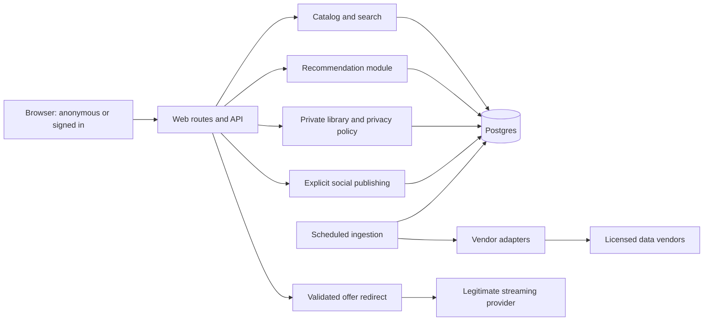

# Product and technical blueprint

Prepared 5 October 2026. Working product name: **NextScene**; naming/trademark/domain clearance has not been performed. Status: foundation for review and phased implementation, not a finished application.

## 1. Product promise and assumptions

Help someone in India answer “What should I watch now, on the services I already have?” Combine explainable, subscription-aware recommendations with deliberate social recommendations. Movie and TV discovery, access without login, multilingual relevance and private watch history are foundational.

Visitors can immediately browse, search, filter, inspect a title and open legitimate watch options. An optional, dismissible first-visit service picker persists locally and is always editable. No OTT accounts are connected. Optional languages, genres and a few familiar-title likes improve anonymous recommendations; none block browsing.

An account adds cross-device library/taste persistence and social publishing. Profiles are public by default with that fact visible at signup, but watched history, ratings, favorites and watchlists begin private. Users publish selected activity intentionally. A public profile does not expose a private diary. The [privacy contract](PRIVACY.md) is binding for every implementation slice.

Initial assumptions: India (`IN`), English UI with multilingual catalog/search support, responsive web, one developer/small team, movies and series, licensed metadata, no playback hosting, no OTT history imports. Add full UI translations later. Adult-content filtering is on by default; account age/minor handling must be resolved before public signup launches. No purchases, subscriptions to vendors or public launch are authorized by this blueprint alone.

Success should be measured by useful choice: shorter time to a relevant detail/watch option, saves, explicit satisfaction and repeat use. A provider click is an intent signal, never proof that a movie was watched.

## 2. Data feasibility and blockers

The complete researched comparison is in [Data strategy](DATA_STRATEGY.md). Proposed split: licensed TMDB metadata + a replaceable licensed availability adapter. Use clearly identified fixtures while credentials and rights are pending.

Critical distinction: TMDB watch-provider data describes where a title may be available by country, but explicitly does not provide full provider deep links. “Watch on [Provider]” requires a valid direct offer URL from another licensed source; otherwise use a truthful “See watch options” CTA. [TMDB documentation](https://developer.themoviedb.org/reference/movie-watch-providers).

Production blockers: commercial data/image permissions, verified India/provider coverage, direct-link entitlement, vendor budget, authenticated smoke tests, deployment/account setup and privacy/security gates. IMDb ratings are optional, not a reason to use unlicensed data. No blanket “all OTTs in India” claim is supportable yet.

## 3. MVP versus later releases

| Stage | Included | Explicit boundary |
| --- | --- | --- |
| Fixture prototype | Premium responsive browse/search/detail, optional service/taste setup, explainable V1 ranking, privacy UX | Development-only labelled fictional/sample data. No claims of live availability or real social users. |
| MVP private beta | Licensed metadata/India offers on verified services; core filters; email authentication; private ratings/history/list; public profiles; explicit recommendations and following; explainable content ranking | No OTT account connection, real-time playback tracking, private messaging, full recommendation ML training or payments. |
| MVP launch | Coverage/freshness gates, safe deep links, abuse reporting/blocking, SEO for permitted title pages, observability, rate limits, accessibility, backup/restore and deletion tests | Marketing lists only actually supported providers. Missing source data remains missing. |
| V1.1 | Richer people/runtime/era/theme discovery, full preference controls, improved transliteration, public curated lists, stronger editorial diversity, notification opt-in | Only source-backed facets and authorized social activity. |
| V2 | Behavioral reranking, permitted content embeddings, offline evaluation and experiments | Requires event quality and demonstrated improvement over V1. |
| V3 | Collaborative/hybrid models, advanced movie clubs and group picks, further regions | Requires sufficient consented signals and safe social aggregation; services separated only when measured scale requires it. |

## 4. Information architecture and main journeys

| Route | Purpose and main controls |
| --- | --- |
| `/` | “For your evening”: useful recommendation immediately, services strip, movie/series toggle, mood/time/language shortcuts, explanations and alternatives. |
| `/discover` | Queryable catalog with shareable filter URL, result count, sort, filter sheet and list/grid state. |
| `/search?q=` | Movies/series/people results; keyboard-friendly suggestions, debounced input, preserved URL and clear empty/error states. |
| `/movie/:id-:slug`, `/series/:id-:slug` | Indexable permitted title details with legitimate watch options, trailer, facts, cast and related titles. Stable ID survives name changes. |
| `/for-you` | Personal ranking; anonymous taste controls or private account context; “Why this?” and tuning actions. |
| `/library` | Owner's Watchlist, Watched, Ratings and Favorites with visible audience labels. Requires account for persistence. |
| `/following` | Current visible recommendations/activity from followed people; sign-in explanation for visitors. |
| `/people`, `/u/:handle` | Public people search and profile projections; Recommend, Ratings and Lists tabs only for published data. No default Recently Watched tab. |
| `/settings/services`, `/settings/taste`, `/settings/privacy` | Subscription/taste editing and separate visibility/personalization/indexing controls. |
| `/settings/account`, `/credits`, `/privacy`, `/terms` | Account export/delete, attribution and product/legal notices. |

Desktop navigation: Discover, For you, Movie club, My list; prominent search and an editable “My services” control. Mobile navigation: Discover, Search, Club, Library, with profile/settings through account controls. Anonymous library attempts explain the benefit of signing in without restricting discovery.

**First visit:** open useful browse view → optionally select services (Skip remains equally visible) → optionally choose languages/genres → inspect recommendations with honest reasons → detail → valid provider link. Preferences survive reload in versioned local storage. Storage failure falls back to the current session; no blocking modal loop.

**Search:** enter title/person → inspect movie/series distinction and alternate names → refine providers/language/genre/year/rating → view detail → select offer type/season where available → provider. Returning preserves scroll, filters and query. Subscription filter uses any selected service (OR), not intersection across all.

**Personalization:** optionally like/rate a handful of familiar titles → compare recommendations → save or dismiss → ask “Why this?” → adjust taste or exclude watched. Signing up offers a preview before importing local preferences; do not silently merge a previous person's browser state into an account.

**Private diary:** detail → Mark watched · Only me → private library. Sharing is a separate composer. Watch on provider does not mark watched. Rating and recommending do not imply watched either.

**Social:** find a handle → view intentionally public content → follow → receive visible recommendations → inspect title → optionally save privately. Following affects recommendation candidates through permitted publications only. Blocking/reporting is available before opening the social beta.

**Privacy:** settings → choose future history audience or share specific existing entries → preview scope → deliberate save. Broadening profile visibility cannot change diary audience. See [privacy semantics](PRIVACY.md).

## 5. Discovery taxonomy

MVP filters: My services/individual providers; movie/series; original language (Hindi, Telugu, Tamil, Malayalam, Kannada, Bengali, Marathi, English); genre; release-year range; named-source rating with minimum vote count; popularity/high-rated/new releases; India offer type. Display incomplete coverage without implying full-catalog search.

Subsequent facets: country of production, runtime for movies / episode runtime when supplied, cast/director/creator, editorial subgenre, mood and themes, new-to-service dates if sourced. Discovery parameters must preserve region even when country-of-production differs.

Separate “Released recently” from “Recently added to a service.” Separate “Highly rated” from “Critically acclaimed”; the latter requires actual critic data or clearly labelled editorial selection. Popularity is vendor-labelled unless we have enough first-party signals. Do not describe global trends as India trends.

Initial editorial moods: absorbing, light, tense, moving, mind-bending and family viewing. Family suitability still requires reliable regional classification/content guidance; a mood tag alone is not a safety certification. Users can clear any inferred preference.

## 6. Technical architecture

Recommend a modular TypeScript application with server-rendered React routes (Next.js App Router), a server API layer and managed PostgreSQL/Auth (Supabase). Keep exact supported versions pinned during scaffolding, after runtime/hosting compatibility checks. Server rendering supports useful public HTML and metadata while small client components provide filters, selectors and interactions. [Next.js server/client architecture](https://nextjs.org/docs/app/getting-started/server-and-client-components).

Use Tailwind tokens plus accessible headless primitives, customized to the design below. Validate all external inputs and adapter payloads with schemas. Use SQL migrations as the database source of truth and generated TypeScript types. Avoid an extra ORM layer until needed.

| Concern | Initial decision | Growth path |
| --- | --- | --- |
| Backend | Same application: catalog, availability, library, social, recommendation and events modules | Extract a module only when its compute/release needs justify it. |
| Database/auth | Supabase Postgres, email verification/passwordless flow, cookie-based server sessions and explicit RLS | Add OAuth providers if requested; no OTT OAuth assumption. |
| Search | Postgres FTS + trigram matching + verified alternate/transliterated names | Dedicated search service after relevance/latency benchmarks show the need. Test Indian scripts explicitly. |
| Recommendation | Deterministic pure TypeScript V1, cached candidate pools and private reranking | Later vector search/learned ranking behind the same interface. |
| Ingestion | Scheduled bounded server jobs, durable job/cursor table, retries and quota budget | Worker/queue if tasks exceed host execution limits. |
| Caching | Licensed public catalog/offer cache in Postgres and safe HTTP caching; personalized responses no-store | Redis only for demonstrated load/rate-limit needs. |
| Assets | Vendor-permitted CDN delivery, responsive sizing and restricted remote host list | Controlled image transformations where rights allow. |
| Measurement | First-party typed events, minimized identifiers, privacy-respecting aggregate dashboards | Optional analytics vendor after consent/data-flow review. |
| Hosting | Portable application package plus managed DB; select compatible host after account/budget review | India-near compute/database where available; measure latency before claiming locality. |
| Source/recovery | Public GitHub under pranayd2126 (owner choice), reviewed source-only changes, CI and deployment rollback | Managed DB backups/PITR and restore drills separately. |

If Sites is selected for hosting during implementation, validate its supported full-stack runtime before scaffolding and adapt the web framework if needed; the domain modules, privacy contract and Postgres model remain unchanged. No hosting service has been registered or deployment promised by this document.



Proposed implementation structure:

```text
src/app/                  public routes, account routes and request handlers
src/components/           accessible product primitives and title components
src/modules/catalog/      canonical metadata and search
src/modules/availability/ offer semantics and URL validation
src/modules/recommendations/ ranking, reasons and evaluation
src/modules/library/      private activity and lists
src/modules/social/       deliberate publishing, following and moderation
src/modules/privacy/      audience policies, consent and deletion
src/adapters/             fixture and licensed vendor implementations
src/server/               auth, jobs, configuration and observability
supabase/migrations/      schema, grants and policies in the same migration
tests/                    ranking, adapters, database policies and journeys
fixtures/                 clearly labelled original development data
docs/                     decisions, source rights and operational runbooks
```

Illustrative API contracts: public catalog/search/title endpoints; authorized `/me/history`, `/me/ratings`, `/me/watchlists`; explicit `/publications` publishing/withdrawal; current-audience `/profiles/:handle` and `/feed`; `/recommendations` using only the current viewer's private context; `/out/:offerId` for validated redirects. Use object-level authorization, idempotency on mutations, bounded pagination, schema validation and stable error codes. Client-supplied scores, owners and consent receipts are never trusted.

The complete [database design](DATABASE_DESIGN.md) covers accounts, catalog, translations, credits, availability, private interactions, social publications, ranking events and deletion. Keep rating/publication state separate so a private rating is not exposed by a public profile join.

## 7. Recommendation V1

Build a useful and inspectable recommender before introducing ML infrastructure. No public match percentages in V1. Internal ranking scores are ordered utility values, not probabilities of enjoyment.

**Candidate generation:** region-specific fresh offers on any selected subscription, matched to base/add-on entitlement. Hard filters enforce selected type/language/genre/year/runtime where specified. Exclude not-interested and, by default, watched titles. Optional “Show outside my services” creates a separately labelled group; when strict filters yield no matches, explain that and offer explicit relaxation. Do not silently change language, subscription or rental constraints. With no services selected, browse verified India offers and prompt gently for services.

Candidate pools combine licensed popularity/quality, content neighbors of liked titles, explicit taste selections and currently visible followee recommendations. Unsupported service coverage cannot satisfy an eligibility gate. Limit source quotas so one popular catalog cannot fill the entire slate.

**Title vector:** versioned, normalized sparse features from genres, verified themes, original language, people, release decade, runtime bin and media type. Use only licensed inputs. Define block weights initially as genre 0.30, theme 0.20, language 0.20, people 0.15, era 0.10, runtime/type 0.05; normalize available blocks. These are engineering starting values, not proven optimal weights.

**Taste vector:** optional onboarding selections plus signed signals: rating `(half_star_value - 6) / 4`, like +0.7, dislike −0.7, favorite +1.0, watchlist +0.2, not-interested exclusion. An unrated watched mark is neutral enjoyment evidence and changes exclusion/recency only. Deduplicate signals per title; explicit current rating supersedes a conflicting like, and cap each title's contribution to prevent repeated clicks overpowering taste. Apply configurable decay to old preferences while allowing users to pin explicit choices. Private vectors are owner-only.

Compute nonnegative similarity to positive preferences and a separate penalty for negative preferences; never normalize a signed vector in a way that makes dislikes positive. Cold-start explicit genre/language choices can supply similarity before title ratings exist. If no taste signal exists, omit the taste term and normalize remaining weights.

**Initial normalized utility:** `0.50 taste + 0.20 quality + 0.10 popularity + 0.10 freshness + 0.10 visible_social − 0.25 negative_affinity`. Each feature is in [0,1], with clip bounds and a versioned definition. Renormalize positive weights over available evidence; a missing value is not evidence of poor quality. Social influence remains capped at 0.10 of positive weight even after normalization; redistribute surplus to available non-social terms. With no applicable evidence, use a stable editorial/canonical fallback order and label it honestly.

- Quality: source-specific Bayesian rating `(v × r + m × C)/(v + m)`, using normalized rating `r`, vote count `v`, catalog mean `C` and a documented prior `m` (initially 100). Never mix sources without calibration.
- Popularity: source-specific log-scaled, capped value normalized within a comparable movie/series pool; avoid globally dominant films monopolizing all languages.
- Freshness: versioned release recency function; newly added-to-service only when its date is sourced. A release date is not an availability date.
- Visible social: distinct followed authors who deliberately recommend/positively rate the title and whose publication the viewer may currently see; cap at three for initial normalization. Watch history is not a social input.
- Diversity rerank: select a slate with initial MMR `0.85 × relevance − 0.15 × maximum feature similarity to selected items`, plus soft franchise and language/provider variety when eligible alternatives exist. Hard user filters always win.

Use a deterministic seed within a session for exploration and a small, labelled “Try something different” pool. Novelty must stay eligible for the user's services and filters. Log model version, candidate source, feature contributions and current explanation evidence without publicizing private signals.

**Reasons are generated from actual features:** “Because you liked [title]” only when it contributed positively; “Matches your Telugu and crime preferences” only for explicit inputs; “On your selected Prime subscription” only with a fresh subscription offer; “[N] people you follow recommended this” only from visible current publications. Do not infer “you watch Telugu crime thrillers” from mere browsing. Show up to two useful reasons and let the owner dismiss/edit the signal. Private reasons are excluded from public share cards and URLs.

**Evaluation:** meaningful unit tests for exclusions, entitlement/region filtering, unknown availability, negative signals, deterministic ordering, missing scores, score bounds, social cap and reason evidence. Compare against a popularity+quality baseline using temporal held-out explicit ratings/saves when enough real data exists. Track NDCG@10/Recall@20, language/provider coverage, diversity, not-interested violations and availability accuracy. Report small-sample uncertainty. A click-through uplift alone is insufficient if saves/satisfaction or trust decline.

**Evolution:** V1 cold-start/content → V1.1 behavior-informed reranking after reliable event collection → V2 licensed embeddings and stronger retrieval → V3 consented collaborative retrieval plus learned reranking. Start a collaborative experiment only when interaction density and temporal evaluation are adequate; a proposed pilot gate is 1,000 opted-in active users and 20,000 meaningful signals with coverage across target languages, not a guarantee of success. Sparse users retain the content fallback. No named-person inference from private cohort behavior.

## 8. Design system and screens

Visual thesis: a calm, dark cinema journal with rich title imagery, warm text and one electric amber accent. The first screen helps choose a title immediately; it is not a marketing landing page or a wall of interchangeable carousels.

Proposed tokens: background `#0B0D12`, raised surface `#171B24`, primary text `#F3F4F7`, secondary text `#B4BCCB`, amber accent `#FFCB66`, accent text `#17120A`, outline `#343C4A`. Validate actual combinations to WCAG AA during implementation. Keep color semantic; privacy uses both a lock icon and text.

Typography: locally hosted licensed Inter for UI and an appropriate Noto Sans script font only when needed; avoid downloading every script family on first load. Body 16px, standard labels 14px, display titles fluid 30–56px. Spacing follows a 4/8px scale; 12px card corners, restrained shadows and strong visible keyboard focus. Main touch targets at least 44px, no essential hover-only actions.

**Home:** compact optional service selector → one featured decision card with “Why this,” accurate provider action, save and alternatives → poster-led sections with distinct jobs: For your mood, Under two hours, From your movie club. A desktop feature can use two columns; mobile shows title/context/actions before secondary imagery. No autoplay trailer.

**Discover:** persistent search, readable active-filter chips, desktop sidebar/mobile bottom sheet, poster grid (two columns at narrow mobile widths, more as space permits), clear pagination/load-more and result state. A deliberate Apply action on mobile avoids filters jumping under the user's finger.

**Details:** readable backdrop overlay, poster/title/year/type, correctly labelled score, synopsis, offer selector, primary Watch action, private Save/Watched/Rate actions, explicit Recommend, trailer on demand, credits, seasons and related titles. Show original language separately from actual offer audio. Missing data disappears or is labelled unknown; never fill with invented facts.

**For you:** clear explanation and lightweight calibration, a small high-quality shortlist, optional variety and visible subscription eligibility. Show “Why this” in plain language rather than a decorative match percentage.

**Movie club/profile:** poster-led recommendation notes with clear author/audience, spoiler-safe text and real visible activity. Owner preview can switch to “View public profile.” Private diary lives in Library. Empty feed invites following people rather than inventing activity.

**Privacy settings:** profile visibility, history future audience, individual shared entries, watchlist visibility, personalization and profile indexing have separate controls. Pair each with concise outcome text. “Only me” is the default history choice, including on mobile and in API-created accounts.

Required UI states: proportionate skeletons; absent image fallback; clear no-results with optional filter reset; no-service selection; unsupported service; stale/unknown offer; vendor outage with retry; auth/session expired; save conflict; empty private library; empty social feed; withdrawn/missing profile/post. An unavailable vendor must not blank already permitted cached metadata.

Use 120–180ms opacity/transform transitions and respect reduced motion. Semantic landmarks, labelled buttons, trapped/restored dialog focus, keyboard navigation, announced save/error results, readable overlays, 200% text zoom and screen-reader checks are acceptance criteria.

## 9. Security, SEO, performance and operations

Validate session and object access on every private read/mutation; CSRF/origin protections for cookie-authenticated writes; rate limits for auth, search, follows, publishing and outbound redirects. Sanitize user bios/recommendation text, enforce a CSP and allowlist external image/video hosts. Treat vendor responses as untrusted input. Outbound URLs require HTTPS and a vetted provider/partner host; reject open-redirect parameters. Never server-fetch arbitrary user URLs.

Secrets stay in `.env` locally and host secret storage in production. Environment examples contain placeholders only; server credentials never receive client/public prefixes. CI secret scanning and dependency checks precede production pushes. `.gitignore` is a guardrail, not protection against deliberately forcing a secret into Git.

Public title routes render crawlable licensed metadata, canonical URLs and accurate Movie/TVSeries structured data. Add source-authorized OpenGraph artwork, sitemap entries only for allowed public pages, robots/noindex for account/search/filter explosions and all development fixtures. Profile indexing is separate opt-in. Private data must be absent from HTML/JSON/OG responses; robots.txt is not access control. Render personalized sections separately from shared public caches.

Performance targets, not measured results: p75 mobile LCP ≤2.5s, INP ≤200ms and CLS ≤0.1. Deliver sized responsive images, reserve image space, lazy-load below-fold posters, load only needed fonts, prioritize one LCP asset and avoid shipping the catalog as browser JavaScript. Establish representative mid-range mobile/network checks and a route JS budget during slice 1.

Observe request latency, errors, vendor freshness/quota, failed offer links, auth failures and private-data access denials without logging secrets or histories. Typed first-party events: search applied, recommendation impression, title opened, watch option clicked, saved, explicitly rated, dismissed and share published/withdrawn. Never translate a click into watched. Basic product operation must work without optional marketing analytics.

Deployment requires isolated dev/staging/production credentials and databases, CI gates, migration review, preview smoke tests, rollback steps, automated backups and a tested restore. Register domain/email sender and verify production auth redirects at that phase. No production user data in previews. Use expand/contract migrations for risky changes and monitor vendor rights/expiry over time.

Monetization later: clearly labelled ad/sponsor slots outside organic ranking, contractual affiliate attribution only, and an optional premium/ad-free product. Sponsored payment cannot change organic scores or explanation text. Private watch history is not an ad-targeting input.

## 10. Delivery plan and acceptance gates

| Slice | Deliverable | Exit evidence |
| --- | --- | --- |
| 0 — Foundation (this delivery) | Requirements, source research, IA, schema design, recommendation design, privacy contract, env template and local version control | Documents cross-linked; secrets ignored; API assumptions explicitly unverified; GitHub connection/destination pending if not supplied. |
| 1 — Anonymous decision flow | Scaffold, tokens/components, original labelled fixtures, service preferences, browse/search/filter/detail, ranking V1 | Works signed out at mobile/desktop sizes; refresh retains local services; all demo offers clearly marked; ranking/filter tests pass; no fake live claims. |
| 2 — Account and private library | Real auth, migrations/RLS, account preferences, ratings/watchlist/watched, export/delete | Owner/other/anonymous database tests pass; marking watched never publishes; independent personalization/visibility controls work. |
| 3 — Live India catalog | Licensed adapters, ID matching, ingestion, coverage/freshness, approved image and offer links | Credentials validated; source rights recorded; India acceptance sample passes; expired/unknown/outage states verified; fixture mode disabled in production. |
| 4 — Deliberate social discovery | Public profiles, follow/search, recommendation composer, audience-filtered feed, block/report | Privacy regression suite and revocation race tests pass; no private history leakage or invented social proof. |
| 5 — Launch hardening | SEO, accessibility, mobile performance, monitoring, recovery, budget controls and deployment documentation | CI passes; browser journeys verified; backup restored; rights/privacy review completed; live smoke tests pass. |
| 6 — Recommendation improvement | Consented measurement, content/behavior experiments and later hybrid ranking | Baseline comparison, sufficient samples, segment fairness/coverage and no privacy/eligibility regressions. |

For each code slice: write a small coherent change, run relevant tests, inspect the mobile and desktop experience, commit and push reviewed source to the requested public GitHub repository when connected, and document behavior/limitations. Avoid generating the entire product before validating the first decision flow.

## 11. Owner inputs and next action

Owner decisions: create a public repository under `pranayd2126`; proposed name `movie-discovery`. Use free development options first, with no paid data commitments. GitHub sign-in/authorized access is still needed. Commercial vendor selection remains deferred until rights, pricing and coverage are established. Put keys in the ignored `.env`, not chat. No keys are necessary to implement slice 1.

The foundation is now concrete enough to begin the first vertical slice. No full implementation has been started in this delivery, honoring the request to establish the blueprint first. Remaining data access decisions can proceed alongside fixture development; commercial purchase and public launch require their own concrete, reviewable decisions.
